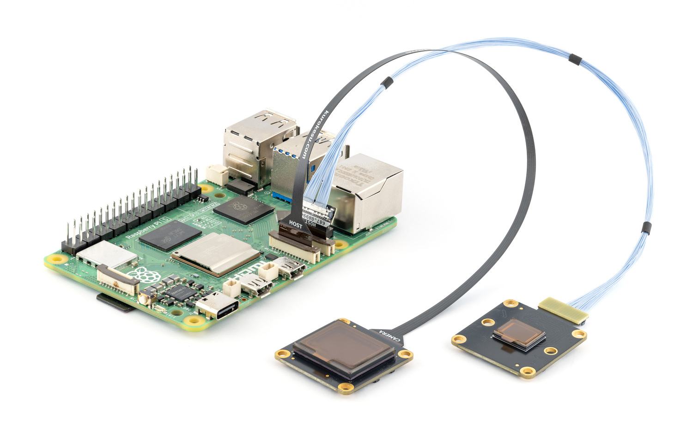

# IMX585 kernel driver for Raspberry Pi

[](https://github.com/Kurokesu/imx585-rpi-driver/actions/workflows/build.yml)
[](https://github.com/Kurokesu/imx585-rpi-driver/actions/workflows/code-style.yml)
[](https://github.com/Kurokesu/imx585-rpi-driver/releases/latest)
[](https://apt.kurokesu.com)
[](https://www.raspberrypi.com/software/operating-systems/)
[](https://github.com/raspberrypi/linux/tree/rpi-6.12.y)

Raspberry Pi kernel driver for Sony IMX585, an 8.3 MP STARVIS 2 back-side illuminated CMOS sensor optimised for low-light and 4K applications.

- 2-lane and 4-lane MIPI CSI-2 (up to 2079 Mbps/lane)
- 10-bit and 12-bit RAW output
- 3840×2160 @ 90 fps (10-bit)
- 3840×2160 @ 60 fps (12-bit)
- 1920×1080 @ 60 fps (2×2 binning)
- [Clear HDR](#clear-hdr) for single-exposure high dynamic range on Raspberry Pi 5
- Mono variant support
- Three sync modes for multi-camera setups



*IMX585 camera modules are available at [kurokesu.com](https://www.kurokesu.com/item/585C-CSI)*

## Install

Connect camera to CSI port with Pi powered off.

Update OS and reboot:

```bash
sudo apt update && sudo apt full-upgrade -y
sudo reboot
```

> [!IMPORTANT]
> If driver or camera stack was previously built from source, run one-time cleanup before first apt install. See [migrating from a source install](#migrating-from-a-source-install).

Enable Kurokesu apt archive (skip if already enabled):

```bash
curl -fsSLO https://apt.kurokesu.com/setup.sh
sudo sh setup.sh
```

Install driver and camera stack:

```bash
sudo apt update
sudo apt install -y imx585-rpi-dkms rpicam-apps
```

*With archive enabled, apt resolves Kurokesu `rpicam-apps` and `libcamera` forks with IMX585 support as updates to stock packages. Later updates arrive with regular `apt upgrade`.*

Edit boot configuration:

```bash
sudo nano /boot/firmware/config.txt
```

Make two changes:

1. Find `camera_auto_detect` near the top and set it to `0`:

```ini
camera_auto_detect=0
```

2. Add `dtoverlay=imx585` under the `[all]` section at the bottom of the file:

```ini
[all]
dtoverlay=imx585
```

*If camera is connected to cam0 port, use `dtoverlay=imx585,cam0` instead. See [cam0](#cam0).*

Save and exit.

`config.txt` changes take effect after reboot:

```bash
sudo reboot
```

Verify camera is detected:

```bash
rpicam-hello --list-cameras
```

Expected output (varies by link frequency and lane configuration):

```
Available cameras
-----------------
0 : imx585 [3840x2160 12-bit RGGB] (/base/axi/pcie@1000120000/rp1/i2c@80000/imx585@1a)
    Modes: 'SRGGB10_CSI2P' : 3840x2160 [43.98 fps - (0, 0)/3840x2160 crop]
           'SRGGB12_CSI2P' : 1920x1080 [50.00 fps - (0, 0)/1920x1080 crop]
                             3840x2160 [43.98 fps - (0, 0)/3840x2160 crop]
```

Start live preview:

```bash
rpicam-hello -t 0
```

On headless systems, capture a still image instead:

```bash
rpicam-still -o test.jpg
```

## dtoverlay options

`imx585` overlay supports comma-separated options to override defaults:

| option | description | default |
|--------|-------------|---------|
| [`cam0`](#cam0) | Use cam0 port instead of cam1 | cam1 |
| [`2lane`](#2lane) | Use 2-lane MIPI CSI-2 | 4 lanes |
| [`mono`](#mono) | Enable mono sensor variant | off |
| [`always-on`](#always-on) | Keep regulator powered (prevents runtime PM power-off) | off |
| [`link-frequency=<Hz>`](#link-frequency) | Set MIPI CSI-2 link frequency (Hz) | 720000000 |
| [`sync-mode=<mode>`](#sync-mode) | Multi-camera synchronization mode | internal-leader |

### cam0

If camera is connected to cam0 port, append `,cam0`:

```ini
dtoverlay=imx585,cam0
```

### 2lane

To use 2-lane MIPI CSI-2 instead of the default 4-lane, append `,2lane`:

```ini
dtoverlay=imx585,2lane
```

> [!NOTE]
> Maximum framerate is roughly halved on 2-lane compared to 4-lane at the same link frequency. See the [link-frequency](#link-frequency) table for exact values.

### mono

For mono sensor variant, append `,mono`:

```ini
dtoverlay=imx585,mono
```

### always-on

`always-on` keeps camera regulator permanently enabled, preventing kernel from powering off the sensor during runtime PM suspend. Useful for debugging hardware issues, since it forces `CAM_GPIO` high constantly.

```ini
dtoverlay=imx585,always-on
```

### link-frequency

Default link frequency is 720 MHz (1440 Mbps/lane). Other values trade MIPI bandwidth against maximum framerate.

To change link frequency, append `,link-frequency=<Hz>`:

```ini
dtoverlay=imx585,link-frequency=594000000
```

| Frequency (Hz) | Mbps/lane | Max FPS @ 4K 12-bit 4-lane | Max FPS @ 4K 12-bit 2-lane | Max FPS @ 4K 10-bit 4-lane | Max FPS @ 4K Clear HDR 4-lane | Max FPS @ 4K Clear HDR 2-lane |
|---|---|---|---|---|---|---|
| 297000000 | 594 | 20.8 fps | 10.4 fps | 25.0 fps | 20.8 fps | 10.4 fps |
| 360000000 | 720 | 25.0 fps | 12.5 fps | 30.0 fps | 25.0 fps | 12.5 fps |
| 445500000 | 891 | 30.0 fps | 15.0 fps | 30.0 fps | 30.0 fps | 15.0 fps |
| 594000000 | 1188 | 41.7 fps | 20.8 fps | 50.0 fps | 30.0 fps | 20.8 fps |
| 720000000 (default) | 1440 | 50.0 fps | 25.0 fps | 60.0 fps | 30.0 fps | 25.0 fps |
| 891000000 | 1782 | 60.0 fps | 30.0 fps | 60.0 fps | 30.0 fps | 30.0 fps |
| 1039500000 | 2079 | 60.0 fps | 35.0 fps | 90.0 fps | 30.0 fps | 30.0 fps |

> [!NOTE]
> Raspberry Pi 5 CSI receiver (RP1) accepts up to 720 MHz (1440 Mbps/lane). 891 MHz and 1039.5 MHz work on Raspberry Pi 4 only.
>
> RP1 processes up to 390 Mpix/s. Normal 4K modes are capped at ≈ 45 fps regardless of link frequency configured here. Clear HDR stays below this limit.

> [!WARNING]
> 1188 MHz (2376 Mbps/lane) is also accepted, but Raspberry Pi 4 does not support this rate and Raspberry Pi 5 exhibits frame drops. Not recommended for production use.

### sync-mode

IMX585 supports three sync modes for multi-camera setups:

| Mode | Description |
|---|---|
| `internal-leader` (default) | Sensor runs from its own internal clock and outputs both `XVS` (vertical sync) and `XHS` (horizontal sync). Other cameras can lock onto these signals. |
| `internal-follower` | Sensor still uses its own clock, but takes in an external `XVS` signal. It aligns vertical sync to this input by adding or subtracting a horizontal sync pulse. |
| `external` | Sensor clock and timing are fully driven by external `XVS` and `XHS` signals. Both syncs are inputs, no outputs are generated. |

```ini
dtoverlay=imx585,sync-mode=internal-follower
```

See the [IMX585 Camera Clock Synchronization Guide](https://github.com/will127534/StarlightEye/wiki/IMX585-Camera-Clock-Synchronization-Guide) for hardware wiring and timing details.

> [!TIP]
> Options can be combined. Example (mono, always-on, cam0, 297 MHz link):
>
> ```ini
> dtoverlay=imx585,mono,always-on,cam0,link-frequency=297000000
> ```

## Clear HDR

IMX585 reads each exposure at high and low gain, then merges both reads on sensor. Single exposure means no ghosting on moving subjects. Merged output is gradation compressed to 12-bit. libcamera expands it back to linear.

> [!IMPORTANT]
> Clear HDR requires Raspberry Pi 5. Raspberry Pi 4 ISP has no decompand block.

Clear HDR is enabled by appending `--hdr` to `rpicam` commands:

```bash
rpicam-still --hdr -o hdr.jpg
```

*`--hdr` also enables ISP tonemapping to hold highlights.*

### List Clear HDR modes

```bash
rpicam-hello --list-cameras --hdr
```

Expected output (varies by link frequency and lane configuration):

```
Available cameras
-----------------
0 : imx585 [3840x2160 12-bit RGGB] (/base/axi/pcie@1000120000/rp1/i2c@80000/imx585@1a)
    Modes: 'SRGGB12_CSI2P' : 3840x2160 [30.00 fps - (0, 0)/3840x2160 crop]
```

### Picamera2

Enable Clear HDR on sensor before opening camera:

```bash
v4l2-ctl -d /dev/v4l-subdev2 -c wide_dynamic_range=1
```

*Subdev number varies. Find it with `grep imx585 /sys/class/video4linux/v4l-subdev*/name`.*

Request tonemapping in configuration:

```python
from libcamera import controls

config = picam2.create_still_configuration(
    controls={"HdrMode": controls.HdrModeEnum.SingleExposure},
)
```

## Build from source

Install required tools:

```bash
sudo apt install -y git
sudo apt install -y --no-install-recommends dkms
```

Clone this repository:

```bash
cd ~
git clone https://github.com/Kurokesu/imx585-rpi-driver.git
cd imx585-rpi-driver/
```

If driver was installed from apt archive previously, remove it first:

```bash
sudo apt remove imx585-rpi-dkms
```

Run install script:

```bash
sudo ./install.sh
```

Camera stack, boot configuration and verification follow [Install](#install). Skip `imx585-rpi-dkms` there, only `rpicam-apps` is needed. To build `libcamera` and `rpicam-apps` from source as well, see [libcamera/BUILDING.md](https://github.com/Kurokesu/libcamera/blob/kurokesu/BUILDING.md).

Run uninstall script to remove driver:

```bash
sudo ./uninstall.sh
```

*`uninstall.sh` removes every `imx585` version installed from source.*

Remove `dtoverlay=imx585` from `/boot/firmware/config.txt`, then reboot.

## Migrating from a source install

One-time cleanup before first apt install.

Remove `imx585` driver installed from source:

```bash
cd ~/imx585-rpi-driver
git pull
sudo ./uninstall.sh
```

*`uninstall.sh` ships with 0.3.0 and later.*

Source-built `libcamera` and `rpicam-apps` install to `/usr/local` and shadow packaged binaries. Remove them:

> [!WARNING]
> Command below deletes everything under `/usr/local` with `libcamera`, `rpicam` or `libpisp` in its name, including custom scripts or files named after them.

```bash
sudo find /usr/local -depth \( -name '*libcamera*' -o -name '*rpicam*' -o -name '*libpisp*' \) -exec rm -rf {} +
```

Cleanup complete. Continue with [install steps](#install).

## Special thanks

- [Will Whang](https://github.com/will127534) for the original IMX585 driver ([imx585-v4l2-driver](https://github.com/will127534/imx585-v4l2-driver)).
- Soho Enterprises for additional register information (passed through from Will's repo).
